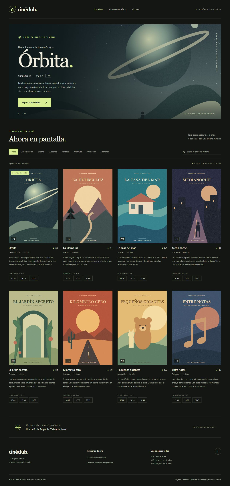

# Semana09 — Cartelera de cine con React y Vite

Fecha: 30 de octubre de 2026, America/Lima.
Proyecto local: `C:\Users\ADMIN\Ciclo4\Empresariales\Semana09`.
Nombre de la experiencia: **Cinéclub**.

## 1. Preparación y ejecución

Se comprobó el entorno antes de crear el proyecto:

```text
node --version → v22.23.3
npm --version  → 10.9.9
```

Se creó mediante la plantilla React de Vite:

```powershell
npm create vite@latest . -- --template react
npm install
npm run dev -- --host 127.0.0.1 --port 5179 --strictPort
```

La plantilla se eligió con `--template react`. create-vite usado: 9.3.3.
Dependencias instaladas: React/React DOM 19.3.1, Vite 8.3.5 y plugin React 6.1.2.
`npm install` finalizó correctamente, sin vulnerabilidades reportadas.
El servidor anunció `http://127.0.0.1:5179/` y se verificó en el navegador.

Para volver a ejecutarlo desde la carpeta del proyecto:

```powershell
npm install
npm run dev
```

Abrir la dirección Local que indique la terminal. Para comprobar la versión
de producción: `npm run build` y después `npm run preview`.

## 2. Limpieza y estructura por responsabilidades

Se eliminaron el contador, los logos, los estilos y las imágenes de ejemplo de
la plantilla. `index.html` contiene metadatos, el contenedor root y main.jsx.
`src/main.jsx` monta App con createRoot y StrictMode e importa los estilos.
`src/App.jsx` compone los componentes sin duplicar la cartelera.

```text
Semana09/
├── index.html
├── package.json / package-lock.json
├── public/images/             8 afiches SVG y un banner, locales y originales
├── src/
│   ├── main.jsx
│   ├── App.jsx
│   ├── components/
│   │   ├── Header.jsx
│   │   ├── Footer.jsx
│   │   ├── Hero.jsx
│   │   ├── MovieCard.jsx
│   │   └── MovieList.jsx
│   ├── data/movies.js
│   └── styles/
│       ├── index.css          Entrada de estilos, define el orden de importación
│       ├── tokens.css         Variables: colores, tipografía, ancho de página
│       ├── base.css           Normalización, elementos y accesibilidad
│       ├── layout.css         Contenedores, columnas y puntos de adaptación
│       └── components.css     Presentación de cada componente
├── experiments/              Ejemplo aislado para provocar y restaurar errores
├── scripts/error-demo.mjs
├── laboratorio-errores.html
└── docs/                     Informe, errores y evidencias
```

**Decisión sobre CSS:** no se proporcionó el archivo de la guía del curso.
Se adoptó la arquitectura anterior, separada por responsabilidades y con un
orden de importación explícito. No se afirma haber cotejado una guía no adjunta.
Los componentes usan clases semánticas y los colores se centralizan en tokens.
Se incluyeron puntos de adaptación a pantallas estrechas, navegación con teclado,
textos alternativos, foco visible y respeto de movimiento reducido.

## 3. Archivo de datos

`src/data/movies.js` exporta el arreglo movies, con ocho películas, y
featuredMovie, seleccionada por su propiedad featured.

| Película | Género | Clasificación | Valoración /10 | Horarios |
|---|---|---|---|---|
| Órbita | Ciencia ficción | +12 | 8.7 | 15:30, 18:15, 21:00 |
| La última luz | Drama | +12 | 8.4 | 14:00, 17:00, 20:00 |
| La casa del mar | Drama | APT | 8.2 | 14:30, 17:15, 19:45 |
| Medianoche | Suspenso | +16 | 8.6 | 16:00, 19:00, 21:45 |
| El jardín secreto | Fantasía | APT | 8.1 | 13:00, 15:30, 18:00 |
| Kilómetro cero | Aventura | +12 | 7.9 | 14:15, 17:30, 20:15 |
| Pequeños gigantes | Animación | APT | 8.5 | 12:00, 14:30, 16:45 |
| Entre notas | Romance | +12 | 8.3 | 15:00, 18:00, 20:45 |

Cada objeto incluye id, title, image, synopsis, classification, rating,
showtimes, genre y duration. La destacada también contiene banner y featured.
Las ocho tienen sinopsis propia y afiche existente en public/images.
Películas, valoraciones, contacto y horarios son ficticios y están identificados
como demostración. Las imágenes son ilustraciones SVG originales, sin servicios
externos, claves de API ni enlaces remotos que puedan dejar de funcionar.

## 4. Componentes y uso de props

- **Header:** nombre del cine y navegación a cartelera, destacada y contacto.
  Se montó y comprobó solo en pantalla antes de continuar. Evidencia:
  [01-header.jpg](evidencias/01-header.jpg).
- **Footer:** contacto ilustrativo, información de clasificación, identificación
  académica y enlace para volver al inicio.
- **Hero:** recibe `{ movie }` por props; muestra su banner, título, género,
  duración, clasificación y sinopsis. El enlace lleva a la cartelera.
- **MovieCard:** recibe `{ movie }`; muestra imagen, título, valoración,
  horarios, clasificación y sinopsis. Cada horario puede seleccionarse como
  demostración, sin simular una venta real.
- **MovieList:** recibe `{ movies }` y recorre las películas mediante map;
  pasa `movie={movie}` y asigna `key={movie.id}` a cada tarjeta.

Composición de App:

```jsx
<Header />
<main>
  <Hero movie={featuredMovie} />
  <MovieList movies={movies} />
  {/* Texto de cierre de la cartelera */}
</main>
<Footer />
```

Ese conjunto está contenido en un único div raíz. Los bucles de géneros y
horarios también tienen sus claves. No se usa el índice como identidad de una
película. La búsqueda ignora tildes y mayúsculas; el filtro de género y la
búsqueda se combinan. Un estado vacío ofrece restaurar la cartelera.

## 5. Comprobaciones reales en navegador

Se utilizó el servidor Vite y se observó el resultado renderizado:

| Comprobación | Resultado observado |
|---|---|
| Header solo antes de continuar | Nombre y tres enlaces visibles |
| Cartelera inicial | 8 tarjetas y los 8 títulos del archivo |
| Imágenes | 8 afiches cargados; complete y naturalWidth positivos |
| Banner | Imagen local y datos de Órbita por props |
| Género Drama | 2 películas: La última luz y La casa del mar |
| Búsqueda orbita sin tilde | 1 película: Órbita |
| Horario Órbita 18:15 | Botón seleccionado y mensaje de función de demostración |
| Búsqueda inexistente | 0 películas y mensaje sin coincidencias |
| Restaurar cartelera | Vuelven las 8 películas |
| Ancho de escritorio 1280 px | Sin desbordamiento horizontal |
| Consola de la aplicación principal | Sin advertencias ni errores |
| Ejemplo de errores al terminar | Página Laboratorio restaurado |

Se intentó verificar una pantalla de 390 px con el navegador disponible, pero
su ajuste de tamaño conservó 1280 px. Por ello no se presenta una captura móvil
como verificación realizada. Los estilos adaptables están implementados;
la comprobación visual registrada corresponde a escritorio.

Captura de la cartelera completa:



## 6. Tres errores deliberados

El procedimiento, los códigos erróneos, los mensajes reales, sus correcciones y
las instrucciones para repetirlos están en [ERRORES.md](ERRORES.md).

| Error provocado | Mensaje principal real | Efecto |
|---|---|---|
| class en lugar de className | Invalid DOM property `class`. Did you mean `className`? | Advertencia de desarrollo; el elemento se dibuja |
| Dos raíces sin contenedor | Adjacent JSX elements must be wrapped in an enclosing tag. | Fallo de compilación del módulo; HTTP 500 |
| map sin key | Each child in a list should have a unique "key" prop. | Advertencia de desarrollo; la lista se dibuja |

No se confunden las advertencias de React con el fallo de sintaxis de JSX.
Los ejemplos se ejecutaron en una página aislada y se restauraron al terminar.

## 7. Compilación y correspondencia con los requisitos

`npm run build` terminó correctamente. El resultado es dist/ y el registro
está en [build.txt](evidencias/build.txt). package-lock.json fija las versiones
resueltas para que `npm ci` permita repetir la instalación.

| Punto | Evidencia |
|---|---|
| 1 | Versiones comprobadas, create-vite React, instalación y servidor real |
| 2 | index.html, main.jsx y App.jsx sin el andamiaje de ejemplo |
| 3 | Carpetas components/data/styles y arquitectura CSS documentada; guía no adjunta |
| 4 | movies.js con 8 películas y los seis campos pedidos |
| 5 | Header y captura previa a la composición completa |
| 6 | Footer con contacto e información |
| 7 | Hero recibe película por props |
| 8 | MovieCard recibe película por props y presenta sus datos |
| 9 | MovieList usa map y key estable |
| 10 | App compuesto y 8 películas verificadas en navegador |
| 11 | Tres errores provocados, registrados, explicados y corregidos |
