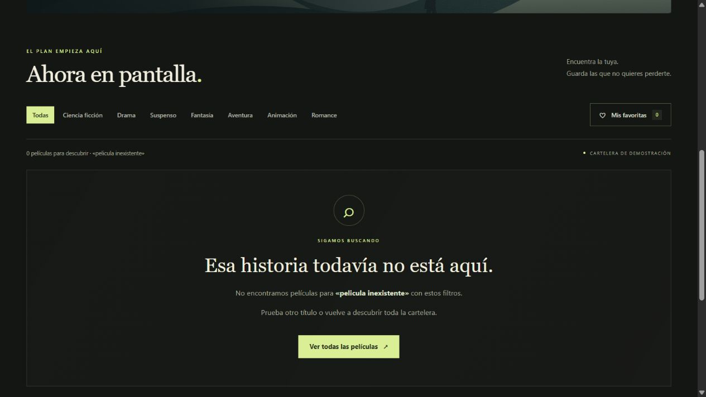

# Semana10 — Componentes reutilizables, estado y persistencia

Fecha: 30 de octubre de 2026, America/Lima.
Proyecto: `C:\Users\ADMIN\Ciclo4\Empresariales\Semana10`.

## 1. Punto de partida y ejecución

Se partió de la versión local terminada de Semana09, que también se había
publicado en el repositorio del curso. Se copiaron sus fuentes, imágenes,
configuración y archivo de versiones a Semana10; el laboratorio anterior
no se modificó. No fue necesario restaurarlo del repositorio.

Antes de ampliar la aplicación se ejecutaron `npm ci`, `npm run build` y
`npm run dev -- --host 127.0.0.1 --port 5180 --strictPort`. La cartelera de ocho
películas se comprobó funcionando en el navegador. Evidencia:
[01-base-semana09.jpg](evidencias/01-base-semana09.jpg).

Entorno: Node 22.23.3, npm 10.9.9, React/React DOM 19.3.1 y Vite 8.3.5.
La instalación finalizó sin vulnerabilidades reportadas.

Para repetir la ejecución desde esta carpeta:

```powershell
npm ci
npm run dev
```

Abrir la URL Local de Vite. Para repetir el mismo origen utilizado en las
evidencias, usar `npm run dev -- --host 127.0.0.1 --port 5180 --strictPort`.

## 2. Estilos base, formulario y utilidades

Se conservó la identidad visual de Cinéclub y se amplió la arquitectura CSS:

| Archivo | Responsabilidad |
|---|---|
| tokens.css | Colores, tipografía y ancho de página compartidos |
| base.css | Normalización, tipografía de formularios, foco, utilidades de texto y avisos |
| layout.css | Contenedores y columnas adaptables |
| components.css | Presentación heredada de la cartelera |
| buttons.css | Variantes de Button, corazones, contador y estado vacío |
| forms.css | Etiqueta, campo controlado, botón de búsqueda y estados del formulario |
| index.css | Orden explícito de importación de las capas anteriores |

El input tiene etiqueta visible, se puede limpiar y se puede enviar con Enter.
Los corazones usan aria-pressed y etiquetas que distinguen agregar de quitar.
Los botones conservan foco visible y el formulario ofrece un mensaje mientras
la consulta está pendiente. Los estilos incluyen adaptación a pantallas estrechas;
la revisión visual registrada corresponde a escritorio.

## 3. Button reutilizable

`src/components/Button.jsx` recibe children para el contenido y variant para el
aspecto. type vale button por defecto, evitando enviar formularios por accidente;
el CTA del buscador usa explícitamente type="submit".

```jsx
<Button variant="primary" type="submit">Buscar <span aria-hidden="true">↗</span></Button>
<Button variant="favorite" aria-pressed={isFavorite} onClick={toggle}>♥</Button>
```

Las variantes utilizadas son primary, secondary, chip, time, icon y favorite.
El componente reenvía onClick, disabled, aria-label y demás atributos nativos.
Todos los botones de la aplicación pasan por él: géneros, funciones, favoritas,
filtro Mis favoritas, limpieza, envío y recuperación del estado vacío.
La única etiqueta HTML `<button>` escrita en src está dentro de Button.jsx.
Los enlaces de navegación siguen siendo enlaces por su semántica.

## 4. Favoritas: estado, props y persistencia

App mantiene favoriteIds con useState. toggleFavorite recibe el identificador
y usa la forma funcional del actualizador para agregarlo o quitarlo de la lista
actual. Se guardan identificadores estables, no copias completas de las películas.

El flujo es `App → MovieList → MovieCard`. Cada tarjeta recibe isFavorite y
onToggleFavorite por props. El clic llama a onToggleFavorite(movie.id).
El corazón cambia de vacío a lleno y actualiza aria-pressed. El contador de la
cabecera y el filtro Mis favoritas usan la misma fuente de verdad.

La inicialización perezosa de useState lee el almacenamiento antes del primer
render. Después, un useEffect persiste cada cambio con JSON.stringify.
La clave es **cineclub:semana10:favorites:v1**.

`src/utils/favoritesStorage.js` valida que el valor guardado sea una lista,
descarta ids desconocidos y duplicados y maneja JSON inválido o errores de acceso.
Si no puede guardar, App muestra un aviso; la selección sigue funcionando
durante esa sesión. No se depende de una lectura tardía que pueda sobrescribir
las favoritas guardadas con una lista vacía al arrancar.

localStorage pertenece al origen: protocolo, host y puerto. Una recarga en el
mismo origen conserva la colección; otro puerto u otro navegador tiene su propia
colección. No es una cuenta en la nube ni una sincronización entre dispositivos.

## 5. Buscador controlado, retardo y filtrado

MovieSearch recibe value y onChange desde App. El input utiliza value={value};
onChange envía el texto nuevo en cada pulsación. No mantiene una segunda copia
del texto en su propio estado.

Hero integra MovieSearch en el banner, junto a la película destacada. Su CTA
Buscar envía el formulario sin recargar la página y desplaza a la cartelera.
La búsqueda por título ignora mayúsculas y tildes, de modo que orbita encuentra
Órbita. Se combina con el género seleccionado y el filtro de favoritas.

useDebouncedValue mantiene la consulta aplicada. Su efecto programa 400 ms
y limpia el temporizador anterior cuando el texto cambia o se desmonta el hook.
App pasa a MovieList la consulta retrasada, no el texto inmediato.
MovieList calcula el resultado con useMemo: el texto bruto no está entre sus
dependencias. Por eso las pulsaciones pueden actualizar la interfaz y el mensaje
pendiente sin volver a filtrar la colección.

No se bloquea el teclado ni se añade una llamada de red ficticia. Mientras se
espera se conservan los resultados anteriores y se muestra Actualizando resultados.
El estado vacío solo aparece cuando la consulta ya se aplicó y no coincide nada.

## 6. Diferencia comprobada en consola

Se escribió orbita letra por letra en el buscador real del banner:

```text
[entrada inmediata] o
[entrada inmediata] or
[entrada inmediata] orb
[entrada inmediata] orbi
[entrada inmediata] orbit
[entrada inmediata] orbita
[búsqueda aplicada] orbita
[filtro ejecutado] {"texto":"orbita","genero":"Todas","soloFavoritas":false,"resultados":1}
```

Resultado: **6 cambios de entrada y 1 ejecución del filtro**. La última entrada
se registró a las 20:50:13.698 UTC y la búsqueda aplicada a las 20:50:14.123 UTC:
**425 ms observados**, coherentes con el mínimo programado de 400 ms más la
planificación del navegador. La tarjeta resultante fue Órbita.

El registro original está en [debounce.json](evidencias/debounce.json).
Los mensajes de diagnóstico se limitan a import.meta.env.DEV. StrictMode puede
repetir el montaje inicial en desarrollo; la comparación se tomó después de
ese montaje, durante una única escritura del usuario. Una pausa mayor a 400 ms
entre letras sí puede aplicar consultas intermedias: es el comportamiento esperado.

## 7. Dónde vive cada dato y por qué

| Dato recordado | Componente o módulo dueño | Motivo de la ubicación | ¿Sobrevive a recarga? |
|---|---|---|---|
| favoriteIds | App, useState | Cabecera, listado y tarjetas comparten la colección; App es su ancestro común | Sí, mediante localStorage |
| searchText inmediato | App, useState | MovieSearch lo edita desde Hero; el filtrado necesita esa consulta en otra rama | No |
| debouncedValue | useDebouncedValue, llamado desde App | Separa el valor escrito del valor aplicado y concentra temporizador y limpieza | No |
| genre | MovieList, useState | Solo interviene en los controles y resultados de ese listado | No |
| onlyFavorites | MovieList, useState | Es un modo de visualización del listado; no es la colección de favoritas | No |
| selectedTime | Cada MovieCard, useState | La función seleccionada solo pertenece a esa tarjeta y no se compra ni reserva | No; también se reinicia si la tarjeta se desmonta al filtrar |
| storageUnavailable | App, useState | El aviso corresponde a la persistencia global de la colección | No; se vuelve a comprobar al guardar |
| movies y featuredMovie | data/movies.js | Son contenido estático compartido; no necesitan useState | Se vuelven a importar al cargar |

Los valores isFavorite, favoriteCount, isPending, genres y filteredMovies se
derivan de los datos anteriores; no se duplican en useState. useMemo conserva
el cálculo del filtro entre renders con dependencias idénticas, pero no lo guarda
entre visitas. useId crea el vínculo accesible entre etiqueta y campo, no almacena
una preferencia del usuario. El identificador del temporizador es local al efecto,
y su limpieza cancela trabajo pendiente; no es un dato de negocio persistente.

Se persisten solo las favoritas porque son la preferencia que debe sobrevivir a
la visita. La búsqueda, el género y los horarios se reinician deliberadamente para
empezar una nueva exploración con las ocho películas.

## 8. Pruebas en navegador y captura del estado vacío

Servidor utilizado: http://127.0.0.1:5180/.

| Comprobación real | Resultado |
|---|---|
| Arranque desde Semana09 | Ocho películas visibles antes de ampliar |
| Entrada controlada | El campo mostró el texto a cada pulsación |
| Retardo | Seis entradas, una aplicación y un filtrado |
| Buscar orbita desde Hero | Una tarjeta: Órbita |
| Agregar Órbita a favoritas | Corazón activo y contador 1 |
| Recargar | Órbita sigue marcada; contador 1 |
| Mis favoritas | Solo se dibuja Órbita |
| Quitar Órbita y recargar | Corazón inactivo y contador 0 |
| Buscar pelicula inexistente y pulsar Buscar | Cero tarjetas y estado vacío visible |
| Ver todas las películas | Limpia texto y filtros; vuelven ocho tarjetas |
| Filtro Drama con Button | Dos películas |
| Función 14:00 de La última luz con Button | Selección visible y mensaje de demostración |

La recuperación tras recarga está registrada en
[favorita-antes-recarga.txt](evidencias/favorita-antes-recarga.txt),
[favorita-despues-recarga.txt](evidencias/favorita-despues-recarga.txt) y
[02-favoritas-recuperadas.jpg](evidencias/02-favoritas-recuperadas.jpg).

Captura solicitada del estado vacío del buscador:



También se entrega [la página completa con la consulta del banner](evidencias/estado-vacio-completo.jpg).

## 9. Verificación técnica y correspondencia

`npm test`: **8 pruebas aprobadas** de persistencia: primera visita, guardado y
lectura, ids duplicados/desconocidos, JSON con forma incorrecta, JSON dañado,
lectura bloqueada, escritura fallida y eliminación persistida. Se usa el ejecutor
nativo de Node, sin instalar otra biblioteca de pruebas.

`npm run build`: compilación correcta de producción. Registros:
[pruebas.txt](evidencias/pruebas.txt) y [build.txt](evidencias/build.txt).

| Punto del laboratorio | Implementación/evidencia |
|---|---|
| 1 | Copia de Semana09, compilación y captura inicial funcionando |
| 2 | Base ampliada y hojas buttons/forms |
| 3 | Button con children, variant y reenvío de atributos; todos los botones lo usan |
| 4 | favoriteIds y toggleFavorite en App |
| 5 | Props hasta MovieCard y corazón con estado actual |
| 6 | MovieSearch controlado desde App |
| 7 | Hook de 400 ms y comparación de consola registrada |
| 8 | MovieList filtra el texto aplicado y muestra estado vacío |
| 9 | Buscador y CTA en Hero, comprobados desde el banner |
| 10 | Inicialización desde localStorage y efecto de guardado; recargas comprobadas |
| 11 | Tabla de propiedad de cada dato y captura del estado vacío incluidas |

Las ocho películas y sus imágenes son contenido ficticio local del laboratorio.
Las funciones seleccionadas no realizan reservas ni compras.
