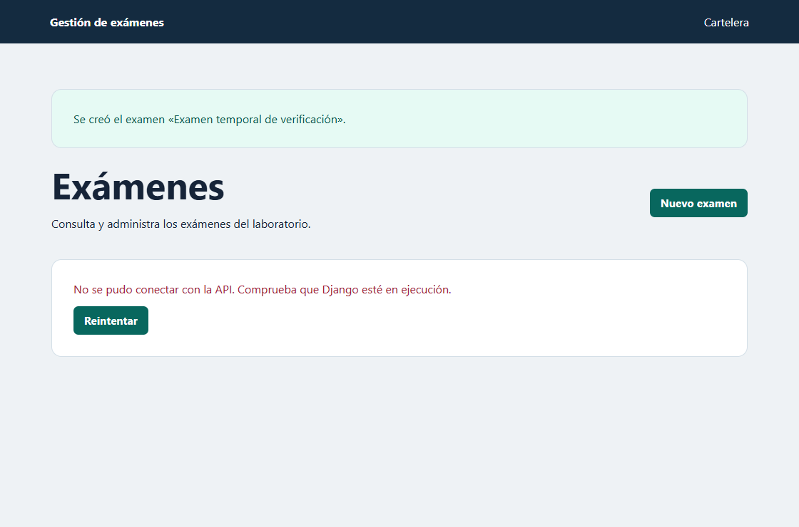
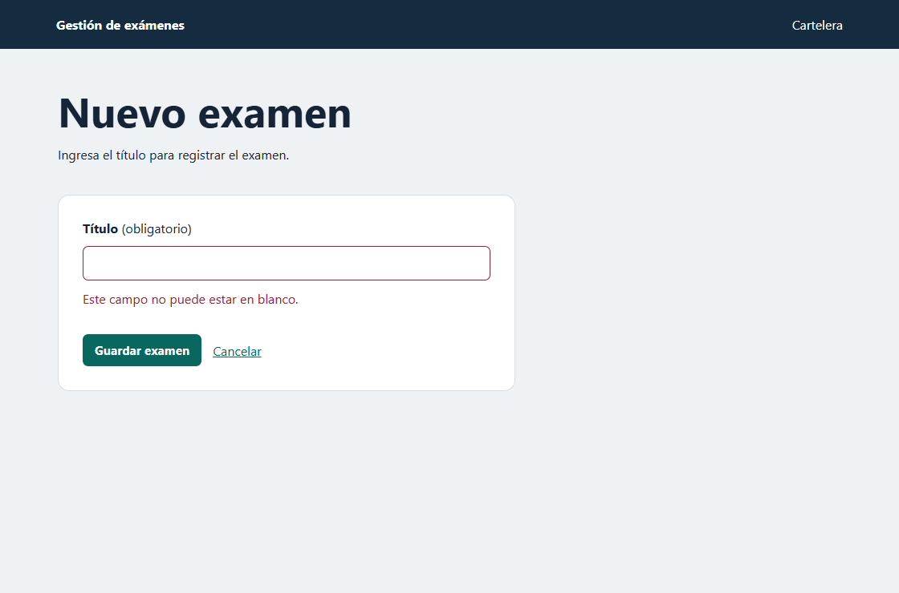

# Laboratorio 12 · Integración de React con Django

La API se copió de Semana08 y se configuró con `corsheaders` en las aplicaciones instaladas. Su middleware quedó inmediatamente después de `SecurityMiddleware`. El origen autorizado es `http://127.0.0.1:5173`. La base de datos es independiente de la del laboratorio anterior.

Las cuatro carpetas de Semana11 encontradas contenían únicamente `.gitkeep`. Se utilizó el proyecto React de Semana10 y se conservó la cartelera en `/cartelera`.

## Direcciones y peticiones

Edge abrió la [dirección base de la API](http://127.0.0.1:8000/api/) y recibió HTTP 401 sin credenciales. Desde React, las peticiones autenticadas devolvieron los datos. La API también publica su [documentación Swagger](http://127.0.0.1:8000/api/docs/).

| Acción | Petición y dirección | Resultado verificado |
| --- | --- | --- |
| Entrar al listado | `GET http://127.0.0.1:8000/api/exams/?page=1` | HTTP 200 con los exámenes de la primera página. |
| Guardar un examen | `POST http://127.0.0.1:8000/api/exams/` | Se envía `{"title":"Título del examen"}`. HTTP 201 y regreso al listado. |
| Eliminar un examen | `DELETE http://127.0.0.1:8000/api/exams/{id}/` | HTTP 204. React vuelve a pedir la lista. |

`react/src/api/exams.js` contiene la dirección base y las tres operaciones de Axios. El listado hace el GET dentro de `useEffect`. El formulario controla el título con estado y usa `preventDefault()` para procesar el envío en React.

## Estados del listado

| Estado | Qué se muestra | Evidencia |
| --- | --- | --- |
| Cargando | «Cargando exámenes…» y tres filas de esqueleto mientras se resuelve el GET. | [Captura](evidencias/01-carga.png) |
| Datos disponibles | Tabla con ID, título, número de preguntas, fecha de alta y botón Eliminar. Si no hay registros, se muestra un aviso. | [Captura](evidencias/02-listado.png) |
| Error de conexión | Mensaje de conexión y botón Reintentar, que vuelve a lanzar el GET de la misma página. | [Captura](evidencias/05-django-apagado.png) |

## Errores reproducidos

**CORS.** Se reinició Django con `REACT_ORIGIN` vacío para retirar el origen permitido. En React, **Actualizar** lanzó otro GET. Edge bloqueó la respuesta y registró el mensaje siguiente. Después se restauró el origen y **Reintentar** recuperó la tabla.

```text
Access to XMLHttpRequest at 'http://127.0.0.1:8000/api/exams/?page=1' from origin 'http://127.0.0.1:5173' has been blocked by CORS policy: No 'Access-Control-Allow-Origin' header is present on the requested resource.
```



[Registro de la consola de Edge](evidencias/consola-cors.txt)

**Validación.** Se pulsó **Guardar examen** con el título vacío. Django respondió HTTP 400 con `{"title":["Este campo no puede estar en blanco."]}`. React conservó el formulario abierto y mostró el mensaje exacto debajo del campo.



**Servidor apagado.** Con React abierto se detuvo Django y se pulsó **Actualizar**. La pantalla mantuvo su estructura, mostró el error de conexión y ofreció **Reintentar**. Tras volver a iniciar Django, el listado se recuperó.


[Registro de las pruebas de navegador](evidencias/verificacion.txt)
