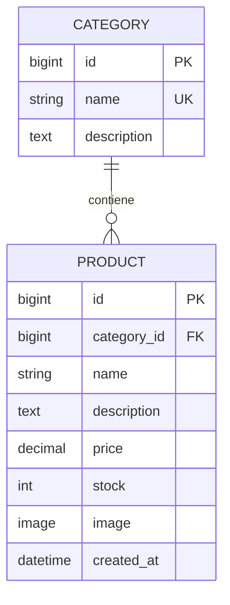

# Laboratorio 13 · Estructura de comercio electrónico

Catálogo de la Tienda Cinéclub con Django REST Framework y React. Parte del proyecto de la Semana 12: los exámenes siguen en `/examenes` y la cartelera en `/cartelera`.

## Cómo levantarlo

Requisitos: Python 3.12 o superior y Node.js 20 o superior. En PowerShell, dentro de `Semana13`:

```powershell
powershell -ExecutionPolicy Bypass -File .\preparar.ps1
```

El script crea `api/.venv`, instala las dependencias, aplica las migraciones, carga tres categorías y nueve productos con imagen, y guarda el token local en `react/.env.local`. Ni la base de datos, ni las imágenes cargadas, ni el token se suben a Git.

Luego, en dos terminales:

```powershell
cd api
.\.venv\Scripts\python.exe manage.py runserver 127.0.0.1:8000
```

```powershell
cd react
npm.cmd run dev
```

| Dirección | Contenido |
| --- | --- |
| http://127.0.0.1:5173/ | Catálogo |
| http://127.0.0.1:8000/api/products/ | Productos con la categoría anidada |
| http://127.0.0.1:8000/api/docs/ | Contrato de la API (requiere sesión) |
| http://127.0.0.1:8000/admin/ | Administrador de Django |

Para entrar al administrador, crea un usuario desde `api`:

```powershell
.\.venv\Scripts\python.exe manage.py createsuperuser
```

Pruebas:

```powershell
cd api
.\.venv\Scripts\python.exe manage.py test
```

```powershell
cd react
npm.cmd test
npm.cmd run lint
npm.cmd run build
```

## Diagrama del catálogo



## API del catálogo

| Método | Ruta | Acción |
| --- | --- | --- |
| GET, POST | `/api/categories/` | Listar y crear categorías |
| GET, PUT, PATCH, DELETE | `/api/categories/{id}/` | Obtener, modificar y eliminar una categoría |
| GET, POST | `/api/products/` | Listar y crear productos |
| GET | `/api/products/?category={id}` | Listar los productos de una categoría |
| GET, PUT, PATCH, DELETE | `/api/products/{id}/` | Obtener, modificar y eliminar un producto |

La lectura es pública. El personal puede hacer todas las escrituras, y el grupo `agente` puede crear y modificar, pero no borrar. Una categoría con productos no se puede eliminar: la API responde 409.

## Reparto entre servidor y cliente

**Servidor (`api/catalog`).** Guarda los datos, valida, aplica los permisos y filtra por categoría. `ProductSerializer` devuelve la categoría completa en `category` y recibe solo su identificador en `category_id`. El listado usa `select_related`, por lo que necesita una sola petición y una sola consulta SQL.

**Cliente (`react/src`).** Muestra la información y recoge los datos de los formularios.

| Carpeta | Responsabilidad |
| --- | --- |
| `services/` | `apiClient` define la dirección base y las credenciales; los demás servicios exponen las operaciones de cada recurso |
| `pages/` | Catálogo y formulario de alta y edición |
| `components/` | Tarjeta, filtro y estructura de la tienda |

Axios solo se importa en `services/apiClient.js`.

## Observaciones

- El diagrama usa los campos que pide la guía.
- El formulario se envía como `multipart/form-data` para incluir la imagen. Al editar sin elegir otra, se conserva la actual.
- Al borrar, el catálogo quita el producto de su estado; al crear o editar, vuelve a consultarlo tras navegar. En ningún caso se recarga la página.
- El token del navegador es solo para el entorno local: Vite lo incluye en el código del cliente, por lo que no sirve para producción.
